# Joomla Google Authentication System Plugin

A Joomla **system plugin** for sign-in and registration with **Google OAuth 2.0 / OpenID Connect**. It adds a "Sign in with Google" button to your login forms, creates or finds the Joomla user, can ask for consent to your Privacy Policy and Terms, syncs a **Community Builder** profile with the Google avatar, and sends the user to the right page afterwards.

**Version 1.10.0** · GPL v2 or later · Author: Tomilin Serhii

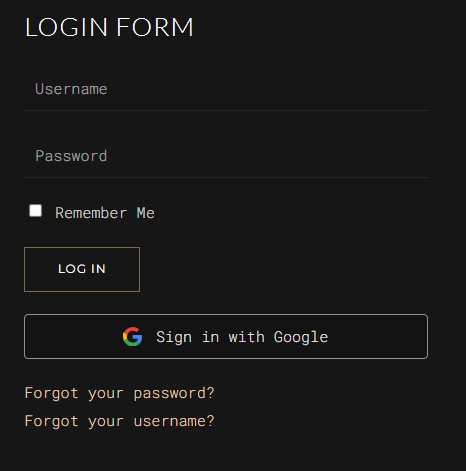

---

## Key features

* **Works with your login forms** – standard Joomla login modules, Community Builder, JReviews and templates such as YOOtheme.
* **Sign-in and registration in one step** – a verified Google account is matched to an existing user or becomes a new one.
* **Own consent screen** – optional Privacy Policy / Terms consent, shown on first sign-in and **again when you publish a new version of a document**.
* **Google's own consent prompt is optional** – a separate switch for Google's permission screen.
* **Button styles** – Light, Dark and Neutral schemes from Google's branding guidelines, logo with text or icon only, rectangular or pill, or a copy of your template's own *Log in* button style.
* **After-sign-in behavior** – stay on the page, open the profile (Community Builder or Joomla), go home, or use a custom URL.
* **Community Builder sync** – profile record, name and Google avatar.
* **Admin notifications** – e-mail chosen administrators about new Google registrations.
* **Languages** – English, Russian, Ukrainian.

---

## Requirements

* Joomla **4.x** / **5.x** / **6.x**
* PHP **8.1** or higher
* A site served over **HTTPS**
* **Community Builder** (optional, detected automatically)

---

## Installation and setup

### 1. Install the plugin

Upload the ZIP in **System → Install → Extensions** (upgrading over an installed version works the same way), then open **System → Plugins → System - Google Auth Login**.

### 2. Create the Google OAuth client

1. In the [Google Cloud Console](https://console.cloud.google.com/) create or select a project and configure the **OAuth consent screen** (the plugin needs only the basic scopes `openid email profile`).
2. **Credentials → Create credentials → OAuth client ID → Web application**.
3. Add this **Authorized redirect URI** (exactly, with your domain):

   ```text
   https://your-site.com/index.php?option=com_ajax&plugin=googleauth&group=system&format=raw
   ```

4. Copy the **Client ID** and **Client secret**.

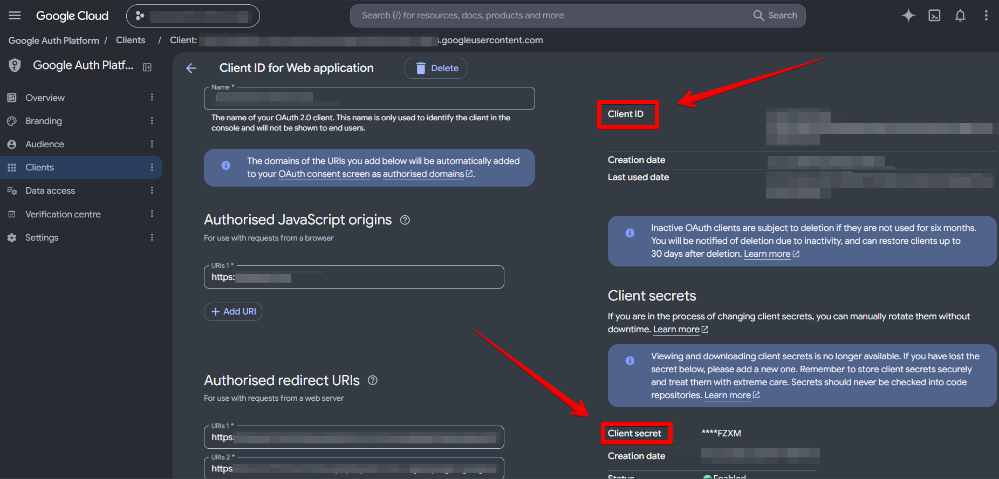

### 3. Configure the plugin

Paste the Client ID and Client secret on the **Basic settings** tab, review the other tabs, set **Status: Enabled** and save.

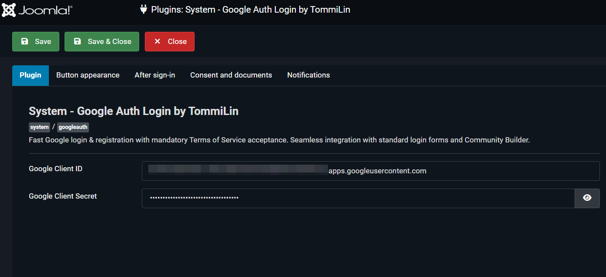

> **Tip.** Joomla 4/5 hides field descriptions by default. Click **Toggle Inline Help** in the top-right corner of the settings screen to show them.

---

## Configuration reference

### Basic settings

| Parameter | Description |
|---|---|
| `client_id` | OAuth Client ID. The button is not shown while this is empty. |
| `client_secret` | OAuth Client secret. Used only on the server. |

### Button appearance

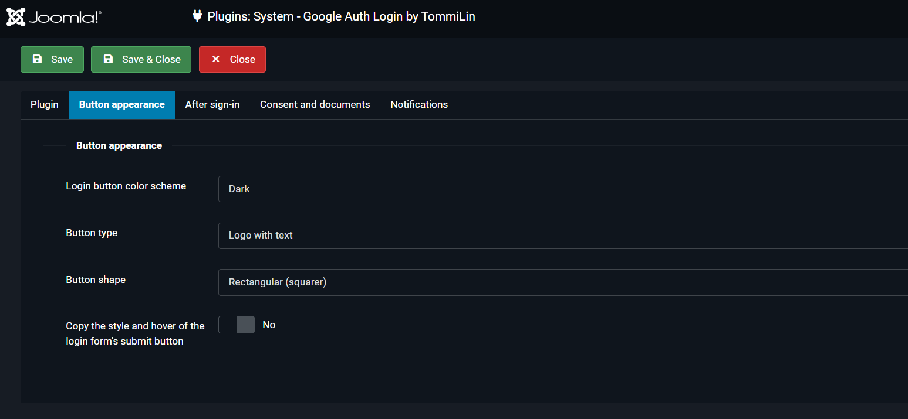

| Parameter | Values (default in bold) | Description |
|---|---|---|
| `button_theme` | **light** / dark / neutral | Color scheme. |
| `button_type` | **standard** / icon | Logo with text, or the Google logo only. |
| `icon_align` | **left** / center / right | Position of the icon-only button. |
| `icon_match_height` | **Yes** / No | Icon button as tall as the form's *Log in* button. No = fixed 40×40 px. |
| `button_shape` | **rectangular** / pill | Squarer corners or fully rounded. |
| `match_submit_style` | Yes / **No** | Copy the style and hover of the form's submit button. Scheme and shape are ignored while on. |

### After sign-in

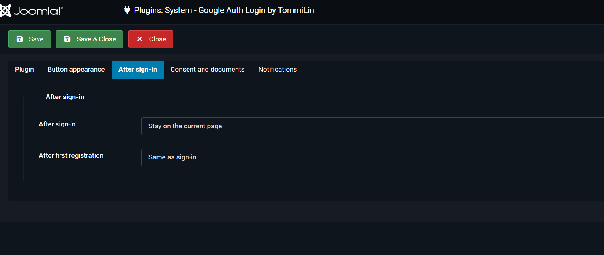

| Parameter | Values (default in bold) | Description |
|---|---|---|
| `redirect_login` | **current** / profile / home / custom | Where a returning user goes. |
| `redirect_login_url` | text | Target for `custom`. |
| `redirect_register` | **same** / current / profile / home / custom | Where a newly registered user goes. `same` = like sign-in. |
| `redirect_register_url` | text | Target for `custom`. |

### Consent and documents

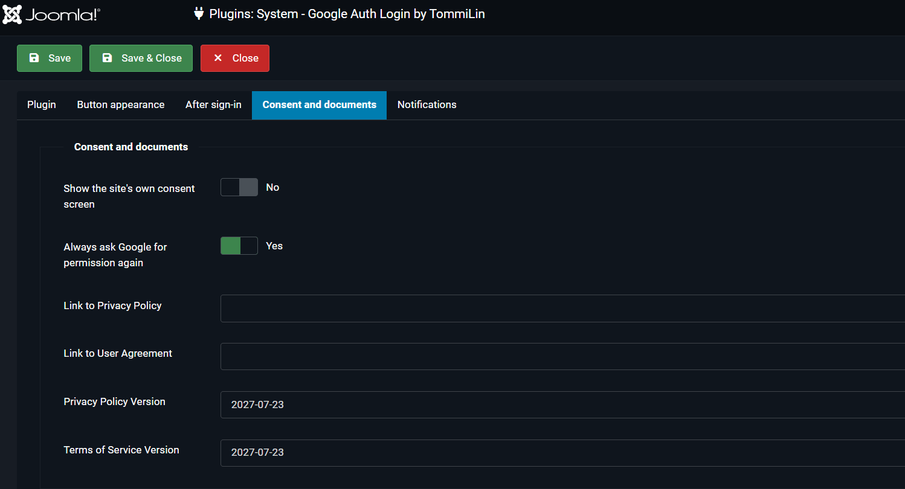

| Parameter | Values (default in bold) | Description |
|---|---|---|
| `require_consent` | **Yes** / No | Show the **site's own** consent screen before creating an account, and again when a document version changes. |
| `force_google_consent` | **Yes** / No | Show **Google's own** permission screen on every sign-in. No = only the account chooser. |
| `privacy_link` | URL | Link to your Privacy Policy. |
| `terms_link` | URL | Link to your Terms / User Agreement. |
| `privacy_version` | text | Version label of the Privacy Policy. **Changing it re-asks every user for consent.** |
| `terms_version` | text | Version label of the Terms. **Changing it re-asks every user for consent.** |

### Notifications

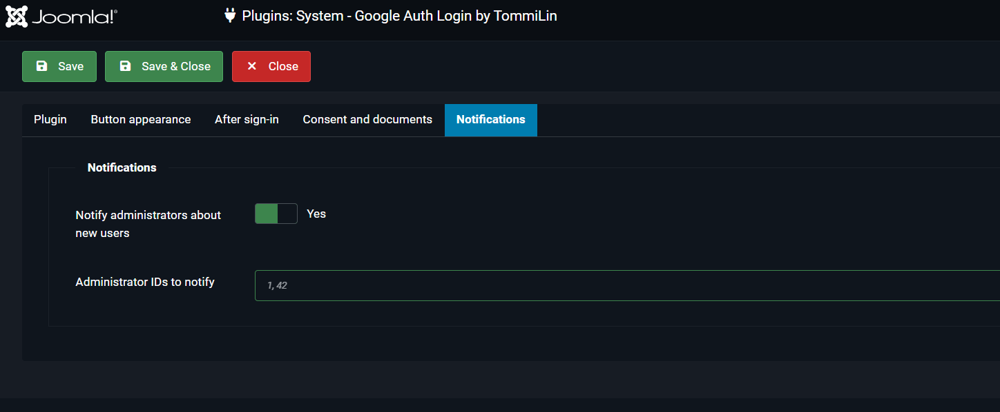

| Parameter | Values | Description |
|---|---|---|
| `notify_admins` | Yes / **No** | E-mail administrators when a new user registers through Google. |
| `admin_notify_ids` | text | Joomla user IDs of the recipients, comma-separated (for example `1, 42`). |

---

## How it works

### Sign-in flow

```text
Visitor opens a page with a login form
      │   onAfterRender: new OAuth state + return URL are stored in the session,
      │   button is injected
      ▼
Click "Sign in with Google"
      │   https://accounts.google.com/o/oauth2/v2/auth
      │   scope=openid email profile, prompt=select_account [consent], state=...
      ▼
Google authenticates the user and redirects back with ?code=...&state=...
      ▼
onAfterInitialise → handleGoogleCallback()
      │   1. validate and consume the state (single use, 10 min TTL)
      │   2. POST code → https://oauth2.googleapis.com/token  (server-to-server)
      │   3. GET https://openidconnect.googleapis.com/v1/userinfo (Bearer token)
      │   4. require email + email_verified = true + sub
      ▼
Resolve the account (by Google ID, then by e-mail)
      ├── existing user, consent not required ──────────► log in
      ├── existing user, consent required ──────────────► consent screen
      ├── new user, require_consent = No ───────────────► create user → log in
      └── new user, require_consent = Yes ──────────────► consent screen
                                                              │
                                                  Accept ─────┴───── Close/Decline
                                                     │                    │
                                       create/update user, CB sync   nothing is created
                                       log in                        redirect to the page
      ▼
Redirect according to "After sign-in" settings
```

### Accounts

A user is found **by Google ID first, then by verified e-mail**. If that e-mail already belongs to a user linked to a *different* Google account, sign-in is refused. New users get a unique username from their e-mail, a random strong password they never need, and the **Registered** group.

---

## Consent

There are **two separate consent screens**:

| | Site's own screen | Google's own screen |
|---|---|---|
| Shown by | This plugin | Google |
| Asks for | Agreement with **your** Privacy Policy / Terms | Permission for your app to read e-mail and basic profile |
| Setting | `require_consent` | `force_google_consent` |

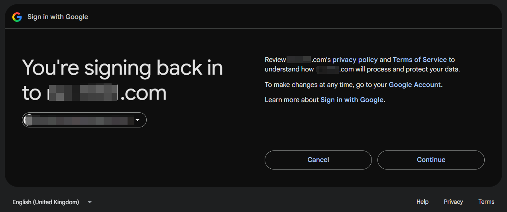

**Site's own screen.** A new account is created **only after the user presses Accept**. If they close or decline, no Joomla user, no Community Builder profile and no personal data are stored.

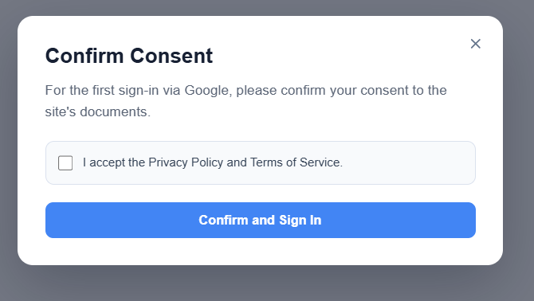

**Updating documents.** The accepted versions are saved for each user. When you change `privacy_version` or `terms_version`, every user whose saved version differs sees the consent screen again on their next Google sign-in, with a message saying which document changed.

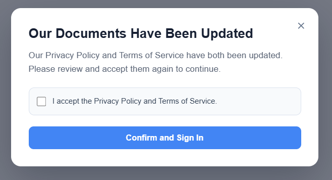

---

## Community Builder

If Community Builder is installed and enabled, the plugin creates the profile record on first sign-in, fills the first and last name, and marks the profile confirmed and approved. The **Google avatar is imported once**, when the profile is created, and is never overwritten on later sign-ins. A Community Builder problem never blocks the sign-in.

---

## Button styles

Colors follow Google's *Sign in with Google* branding guidelines; the "G" logo always keeps its brand colors.

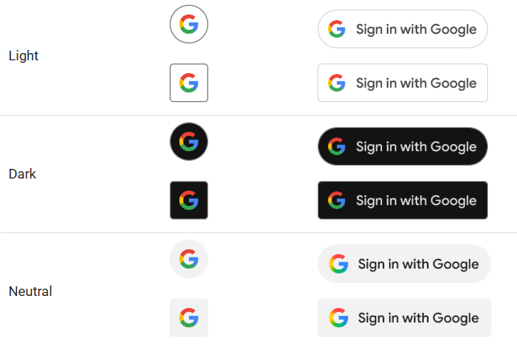

| Scheme | Fill | Border | Text |
|---|---|---|---|
| Light | `#FFFFFF` | `#747775` | `#1F1F1F` |
| Dark | `#131314` | `#8E918F` | `#E3E3E3` |
| Neutral | `#F2F2F2` | none | `#1F1F1F` |

The button can be a **standard** button (logo and text) or **icon only**, with **rectangular** or **pill** corners. On hover the button gets a soft "lift" shadow that stays visible on both light and dark pages.

**Copy the template's style.** With `match_submit_style` enabled, the Google button takes the CSS classes of the form's own *Log in* button, so its look and hover come from your template. The scheme and shape settings are then ignored.

> Google's guidelines ask for the colored logo on a light, dark or neutral background. In the copy mode the logo sits on your template's button color, which may not follow that rule.

---

## After sign-in

| Mode | Where the user goes |
|---|---|
| `current` | The page where the sign-in started (with its query string). Falls back to the home page for a login page or a foreign URL. |
| `profile` | Community Builder profile if CB is active, otherwise the Joomla profile. |
| `home` | The home page. |
| `custom` | Your URL: a full address, a path like `/profile`, or a Joomla link like `index.php?option=…`. |

`redirect_register` offers the same choices for a user who has just registered (`same` reuses the sign-in setting). Errors always lead to the home page.

---

## Administrator notifications

When `notify_admins` is on, the listed administrators get an e-mail each time a **new account** is created through Google:

> A new user has registered on the site *{site name}* via the Google authentication plugin. New user ID in the database: *{id}*

Each recipient gets a separate message. Blocked users, unknown IDs and users without an e-mail are skipped. Mail uses Joomla's global mail settings, and a mail failure never blocks the registration.

---

## Security

* CSRF protection with a random single-use `state` that expires after 10 minutes.
* Server-side token exchange; the profile is read from Google's OpenID Connect endpoint, not from URL parameters.
* Only Google accounts with a **verified e-mail** are accepted.
* Nothing is created before the user accepts the consent screen, which expires after 15 minutes.
* The client secret, tokens and passwords are never written to the log.

Plugin events are logged to `googleauth.log.php` in Joomla's log folder (**System → Global Configuration → Server → Logging**).

---

## Troubleshooting

| Problem | What to check |
|---|---|
| The button does not appear | The plugin is enabled, `client_id` is filled, you are logged out, and the form is a standard login form. Clear the Joomla and browser caches. |
| `redirect_uri_mismatch` from Google | The redirect URI in Google Cloud must match the callback URL exactly, including `https://`. |
| Error after returning from Google | The login page was open for more than 10 minutes. Reload it and try again. |
| "E-mail not verified" | The Google account's e-mail is not verified. |
| E-mail linked to another Google account | A Joomla user with this e-mail is already bound to a different Google ID. |
| Users are asked for consent again | `privacy_version` or `terms_version` was changed – this is intended. |
| No admin e-mails | Check `notify_admins`, the IDs, and Joomla's mail settings. See the log. |
| No avatar in Community Builder | The avatar is imported only when the CB profile is first created. See the log. |
| Descriptions are not visible in settings | Click **Toggle Inline Help**. |

---

## Changelog

* **1.10.0** – After sign-in settings (current page / profile / home / custom URL, separate for first registration).
Icon-only and pill buttons, icon alignment and height, copying the submit button style.
Light, Dark and Neutral color schemes and the hover effect.
Administrator notifications; the button now also appears in YOOtheme 5 and other templates with numbered login form ids.
Switch for Google's own consent screen; clearer option names; fixed broken language files (ru-RU, uk-UA).

## Updates

New versions are offered in **System → Update → Extensions** through the update server:
`https://raw.githubusercontent.com/TommiLin/Google-Auth-Login-Joomla-Plugin/main/updates.xml`

## License

GNU General Public License v2 or later. Copyright (C) 2026 Tomilin Serhii.
